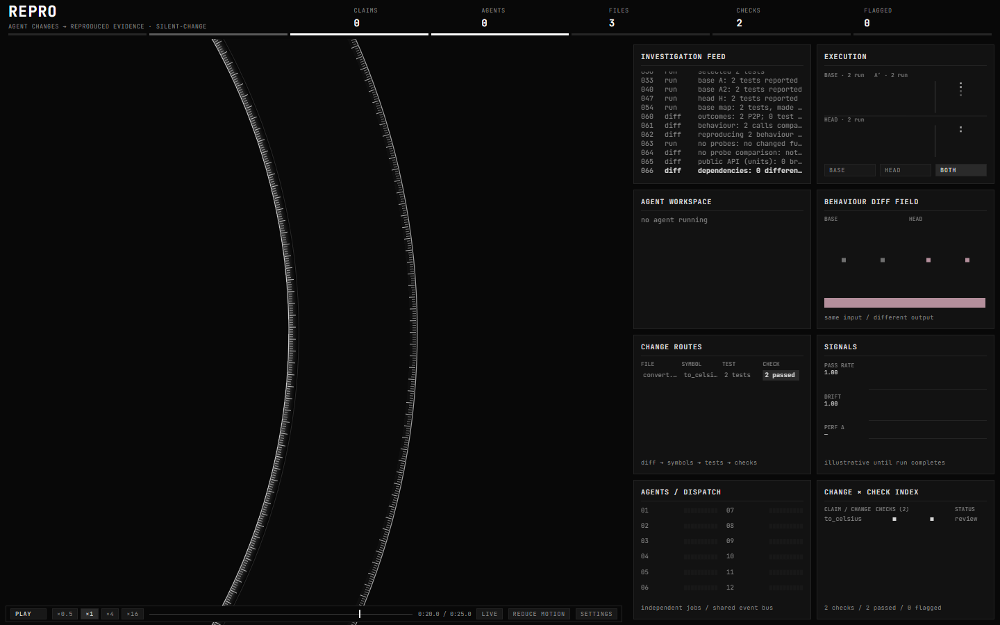
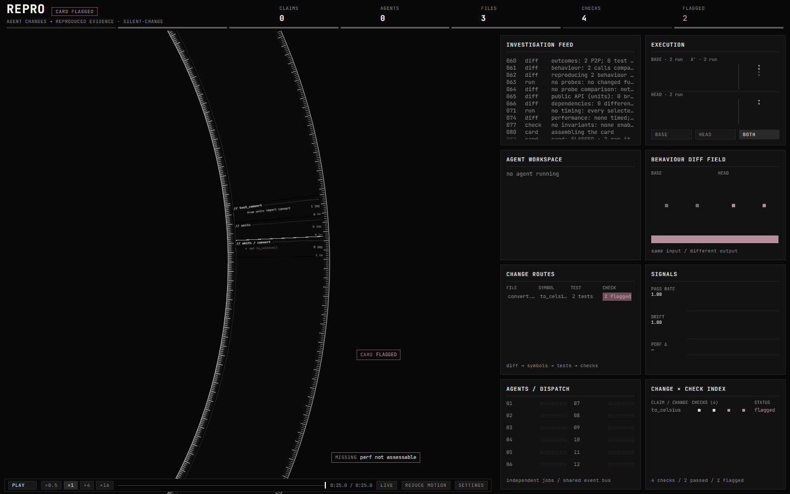
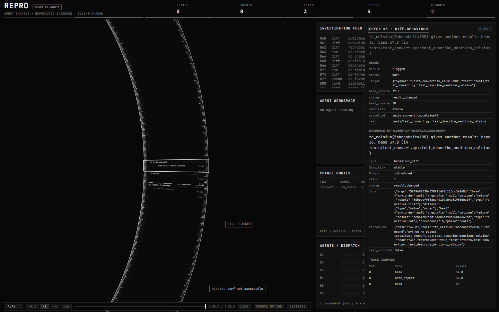
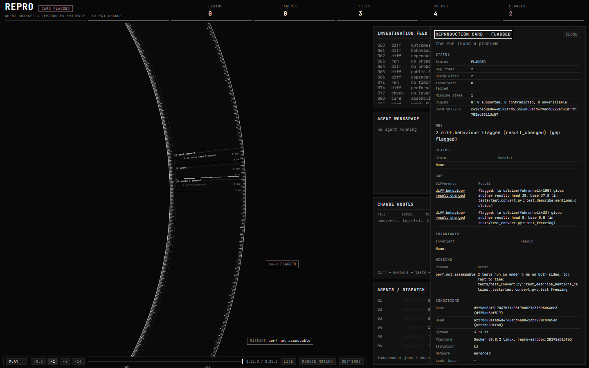

# The demo: a change no test catches

One real run, recorded: the command, what the cockpit showed, and the card. Everything here
comes from a single run of Repro 0.7.0 on Windows, in a container (L3), with agents off.

## The change
`silent-change` is one of Repro's fixture repositories (`engine/tests/fixtures`). Base:

```python
def to_celsius(fahrenheit):
    return round((fahrenheit - 32) * 5 / 9, 1)


def describe(fahrenheit):
    return f"{to_celsius(fahrenheit)} C"
```

```python
def test_freezing():
    assert to_celsius(32) == 0


def test_describe_mentions_celsius():
    assert describe(100).endswith(" C")
```

The head branch, `change/tidy-convert`, whose commit says "Simplify to_celsius().", drops the
`, 1`: `to_celsius` now rounds to whole degrees, and returns an `int`. Both tests pass on both
sides. A review that reads CI sees a green change.

## The run
From a checkout (`uv sync`), build the fixture next to the checkout, not inside it, then run
Repro on it from the checkout's root:

```bash
cd engine/tests && uv run python -m fixtures silent-change ../../../silent-change
```

```bash
uv run repro run --repo ../silent-change --base main --head change/tidy-convert
```

The fixture is built the same way every time, so its commits are always `d929cb8bf517` (base)
and `a22fb680efad` (head).

## What the cockpit showed
**Near the end of the run.** Base has run twice (A and A′) and head once, two tests each, and
every test passed: the two outcome checks passed (CHECKS 2, FLAGGED 0). But the behaviour diff
field already shows `to_celsius`'s calls differing between base and head, with the same input.



**Finished.** The card is FLAGGED. Change routes follow the changed function, `to_celsius`,
through its 2 tests to 2 flagged checks. The Missing tag at the bottom is the one thing the run
could not check: the tests are too fast to time.



**A flagged check, opened.** Clicking one (here in the change × check index) opens its
evidence. `to_celsius(fahrenheit=100)` gave `37.8` on both of base's runs and `38` on head, and
the reproducer names the test that shows it. Because base's two runs agree, the difference is
`stable`: not noise.



**The card**, as the cockpit's card drawer shows it.



## The card
[demo/card.md](demo/card.md) is the same run's card, from
`repro export <run> --format md`. Its gap, in short:

| Check | Kind | Summary | Result |
|---|---|---|---|
| diff.behaviour | result_changed | `to_celsius(fahrenheit=100)`: head 38, base 37.8 | flagged |
| diff.behaviour | result_changed | `to_celsius(fahrenheit=32)`: head 0, base 0.0 | flagged |

The second one is easy to miss even when reading the diff: `0 == 0.0`, so `test_freezing`
passes, but the function now returns another type.

The run had agents off, so no claim could explain the differences, and every difference flags.
With agents on, the commit's claim, "Simplify to_celsius()", is judged against these two
pieces of evidence. [Reading a card](reading-a-card.md) explains each part.

## Making the recording again
The stills are frames of `repro replay`, from the stored event log alone, at a fixed point of
the run and with a focus set, so they can be made again:

```bash
pnpm build
```

```bash
REPRO_DEMO_OUT=docs/guide/demo pnpm --filter @repro/web exec playwright test -c playwright.gate.config.ts demo.spec.ts
```

(`apps/web/gate/demo.spec.ts`; add `REPRO_GATE_CHANNEL=msedge` on Windows.) Run IDs, evidence
IDs and timings differ from one recording to the next; what the run finds does not.
